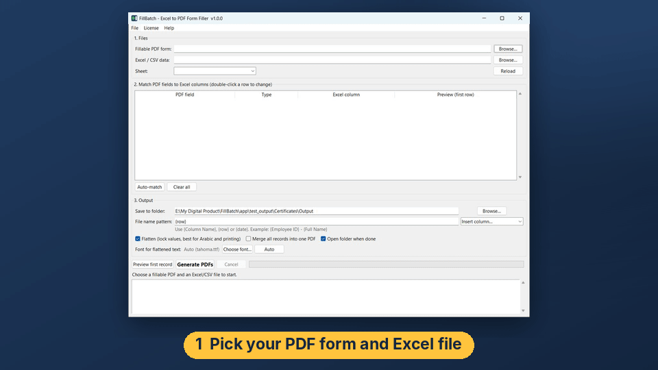
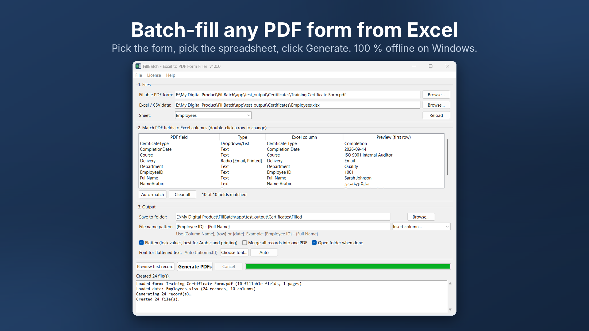
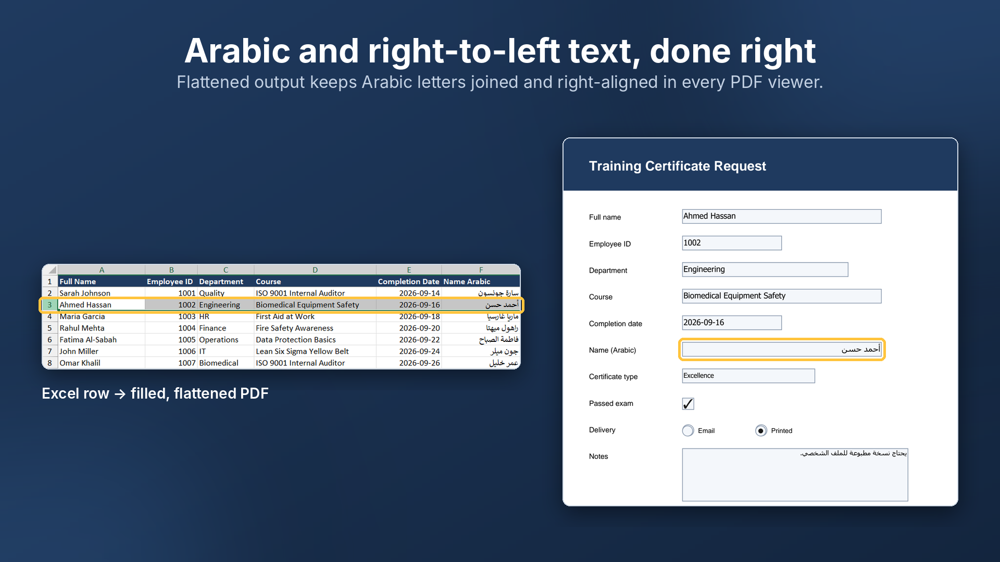

# FillBatch — Fill PDF Forms from Excel (Windows)

Fill one fillable PDF form for **every row of an Excel or CSV file** — in about a minute.
Offline, no Adobe Acrobat Pro, and correct **Arabic / right-to-left** text.

## Download

- **Free edition** (every feature, 10 records per run): [Download the latest release](https://github.com/sherifdd12/fillbatch/releases/latest)
- **Full version** ($19 one-time, 3 PCs, free v1.x updates): [Buy on Gumroad](https://deskreadyhq.gumroad.com/l/fillbatch)

Website: https://sherifdd12.github.io/fillbatch/

## How it works

1. Open your fillable PDF.
2. Open your Excel or CSV file.
3. FillBatch matches the columns to the form fields automatically.
4. Click **Generate**. Done.

## Features

- One PDF per row, or one merged PDF ready to print
- File names from your data, e.g. `1042 - Sarah Johnson.pdf`
- Text, checkboxes, radio buttons, dropdowns, multiline notes
- Flatten option: lock the values so nobody can edit them
- Full Arabic / right-to-left support
- Remembers your field matches for each form
- 100 % offline — your HR, tax or patient data never leaves your PC

## Requirements

Windows 10 or 11 (64-bit). Works with standard fillable PDFs (AcroForms). Dynamic XFA forms are not supported.

## FAQ

**Do I need Adobe Acrobat?** No.

**Is my data uploaded anywhere?** No. Only your license key is checked once during activation.

**Windows says "Windows protected your PC".** The installer is new and not code-signed yet. Click **More info → Run anyway**.

**My PDF isn't fillable.** Add form fields first with a free editor (LibreOffice Draw) or Acrobat's Prepare Form, then use FillBatch.

**Mac?** Windows only for now.

**Support:** reply to your Gumroad receipt email, or open an issue in this repository.

---
This repository hosts the website and the free downloads. The application source is not public.
